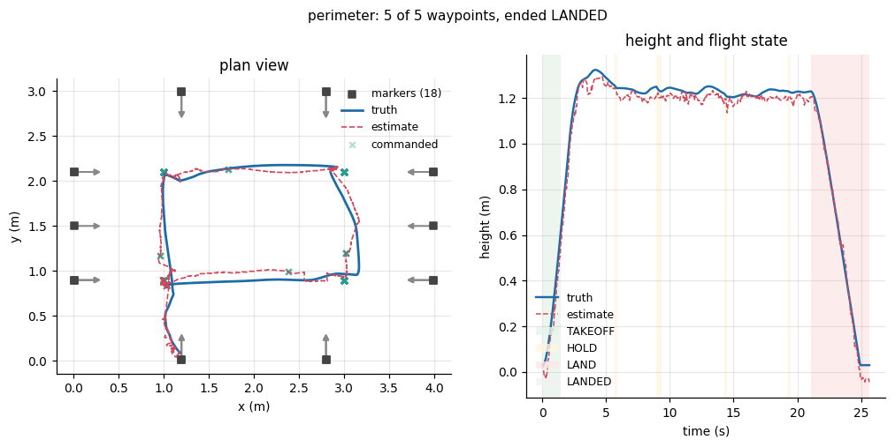
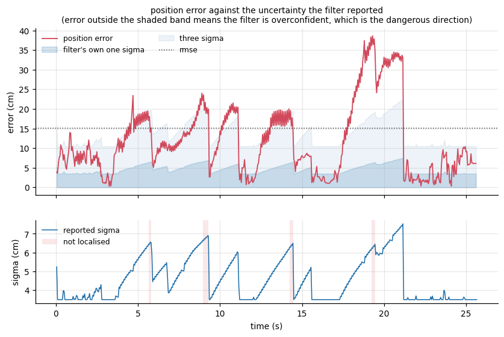
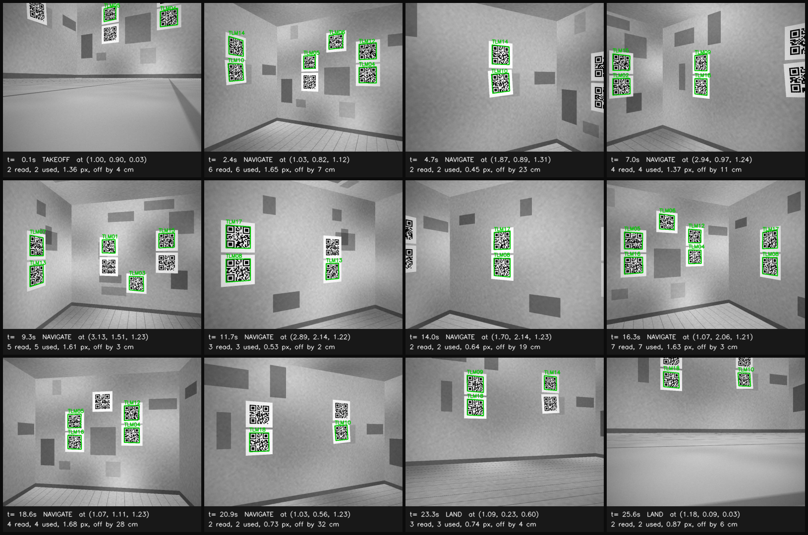

# ros2-tello-navigation

Indoor autonomous flight without GPS. QR markers at surveyed positions give
absolute pose, fused with the aircraft's inertial data and a visual-odometry front
end, driving a PID waypoint controller behind a failsafe state machine that will
land the aircraft on its own.

```
  maps/marker_map.yaml : 18 surveyed markers in a 4.0 x 3.0 x 2.4 m room
                                  |
                                  v
  camera  --> QR detect     --> multi-marker PnP   --> MarkerFix
  960x720     aruco +           with a covariance      position, yaw, 3x3
  30 Hz       classic           from the Jacobian          |
                                                           v
  camera  --> visual odometry --> body velocity --------> EKF --> NavState
              de-rotated LK flow                       11 states  p, v, yaw,
                                                           ^      biases
  telemetry --> decode cm, dm/s, deg --> SI, REP-103 ------+
  10 Hz                                                    |
                                                           v
                                            failsafe machine --> may it fly?
                                            8 states, 11 causes      |
                                                                     v
                                            waypoint controller --> rc a b c d
```

> ### There is no aircraft
>
> This was built and tested entirely against a simulator and an emulator. No line
> of it has exchanged a packet with a Tello, no marker has been printed and no room
> has been surveyed. Every figure below is a statement about the algorithms, not
> about a DJI Tello.
>
> That is said here, in the output of every script that reports an accuracy and
> in the metadata of every results file. **[docs/HARDWARE.md](docs/HARDWARE.md)**
> is the complete list of what is asserted without evidence, what it would cost to
> check and in what order.

---

## Run it

```bash
make setup     # pip install -r requirements.txt
make demo      # fly the reference mission and write the log
make figures   # redraw every figure from it
```

Or with no Python on the machine at all:

```bash
docker compose up
```

Three minutes, no ROS, no hardware. It flies `missions/perimeter.yaml` in the
simulator and writes `results/latest/` and `analysis/figures/`.

```bash
make test        # 344 tests, under two minutes
make validate    # check the marker map and every mission before flying them
make detection   # measure what the detector can actually read
make failsafe    # fly every failure case and keep the evidence
make markers     # printable marker sheets with crop marks
```

The ROS 2 graph flies the same logic against a **Tello emulator**: a simulated
aircraft that speaks Tello SDK 2.0 on UDP 8889, sends state strings to 8890 and
streams H.264 to 11111, so the real driver, its PyAV decoder and every node run
exactly as they would against a drone. CI builds the workspace with colcon and
flies three launch tests against it: a waypoint mission, a link loss and a low
battery, each asserted against the emulator's simulated ground truth.

```bash
docker build -f docker/ros2/Dockerfile -t tello-ros2 .
docker run --rm --network none tello-ros2               # the launch tests
ros2 launch tello_bringup emulator.launch.py auto_arm:=true   # in a Humble workspace
```

See [docs/EMULATOR.md](docs/EMULATOR.md) and [docs/ROS2.md](docs/ROS2.md).

---

## Results

<!-- BEGIN GENERATED RESULTS -->
`missions/perimeter.yaml`: four corners of a 4.0 x 3.0 m room at 1.20 m,
automatic heading, one loop, then a landing. Flown with `make demo`.

| | |
| --- | --- |
| waypoints reached | **5 of 5** |
| arrival error, RMSE | **7.5 cm** |
| localised, fraction of flight | **95.7 per cent** |
| longest gap without a fix | 0.4 s |
| marker fixes | 190 at 7.4 Hz, 95 per cent accepted |
| reprojection residual, median | 0.80 px |
| position error, RMSE *(simulator truth)* | **15.1 cm** |
| position error, 95th percentile *(simulator truth)* | 32.8 cm |
| heading error, RMSE *(simulator truth)* | 2.14 deg |
| failure cases flown | 7, of which 5 were ended by a failsafe, all on the ground |
| ended | LANDED (NONE) |

Marker map `survey: designed`, camera model `nominal-fov`, simulator seed 1.
<!-- END GENERATED RESULTS -->

Everything above is generated by `scripts/make_results.py` from files under
`results/` and every one of those files is produced by a script in this
repository. Nothing is typed in by hand.

Full tables, the measured detector curves, the failsafe evidence and the tuning
sensitivity sweep are in **[docs/RESULTS.md](docs/RESULTS.md)**.





The second figure is the one worth dwelling on. The red trace leaving the shaded
band means the filter is more confident than it has earned, which is the
dangerous direction: a navigation filter that knows it is lost can hold, while
one that is wrong and certain flies into a wall. The sawtooth is the honest
shape, uncertainty growing between fixes and collapsing when one arrives.

The brief asks for a flight video. There is no aircraft and no footage and a
video of a simulation would be a video of this repository's own renderer rather
than evidence about anything. `analysis/figures/camera_frames.png` is the honest
substitute: twelve frames from the reference flight, re-rendered at the poses the
aircraft occupied, with the detector run over each and what it found drawn on. It
shows the thing a video would not, which is the image quality the detector is
working with.



### Which numbers mean what

The figures divide in two and the division matters more than any of them.

**Statements about the simulator**, needing ground truth: position error, heading
error, the consistency ratio. These say the algorithms are correctly implemented
and internally consistent against a known error model.

**Statements that would carry over to hardware**, needing no truth at all:
localisation availability, fix rate, reprojection residual, detection rate against
range and turn rate and the static survey check. These are measured the same way
on a real flight.

`eval/metrics.py` enforces the split in code: `evaluate()` omits the ground-truth
metrics entirely when a log has none, rather than reporting them as NaN, so a
results file from a real flight cannot be misread.

---

## How it works

Full account in [docs/ARCHITECTURE.md](docs/ARCHITECTURE.md). The parts worth
knowing before reading the code:

**The markers are the only absolute measurement.** Everything else, the
accelerometer and the visual odometry alike, says how the state changed. Only a
marker fix says where the aircraft is. That is why fixes carry a real covariance
derived from the projection Jacobian rather than a tuned constant, why there is a
heading planner at all and why losing sight of the markers is a failsafe condition
rather than an inconvenience.

**Markers come in pairs.** A single square marker leaves its own tilt almost
unobservable head on, so half a pixel of corner noise swings the solved pose by
several degrees: about 15 cm of lateral error at 1.5 m. A second marker 45 cm away
in the same view turns a 300 mm object into a 750 mm one and the measured fix error
drops under 3 cm. A factor of five, for the cost of printing twice as many sheets.

**Where the aircraft points decides whether it knows where it is**, because the
only camera faces forward. The heading planner scores candidate headings by
projected marker area and holds a heading until it stops being good enough rather
than chasing the best one, because a camera that is always turning is always
blurred.

**The failsafe sits between the estimate and the command**, not beside them.
[docs/FAILSAFE.md](docs/FAILSAFE.md) covers the eight states, the eleven cause
codes, the priority order and every threshold with its justification. The one
behaviour worth reading about even if you read nothing else: **on link loss the
controller stops transmitting.** A Tello lands itself fifteen seconds after the
last command it hears and on a degraded link an rc command that gets through
resets that timer, so a controller that keeps talking can keep an aircraft it has
no control over airborne. Falling silent hands the aircraft to its own failsafe,
which is the only thing still able to act.

**There is a `tello_core`.** Every algorithm lives in plain Python that imports no
ROS; the ROS 2 packages subscribe, convert, call into it and publish. That is what
lets the whole test suite run in half a minute on any machine and what means
the offline runner, the ROS graph and the tests all drive one implementation of the
flight logic.

---

## The simulator and what it is for

`src/tello_core/sim` is a deliberate substitute for hardware, built to be wrong in
the ways a Tello is wrong rather than realistic in general.

A real QR symbol from OpenCV's encoder is printed into a textured room at its
surveyed position, rendered by an exact nearest-hit ray caster so occlusion is
correct, degraded with motion blur, vignetting, signal-dependent sensor noise and a
JPEG round trip and then found by the same `cv2.QRCodeDetectorAruco` that would
run on hardware. When detection fails in simulation it fails for the reasons it
would fail in a room.

Telemetry is serialised into genuine Tello state strings and parsed back by the
same decoder the real driver uses, so the unit conversions and the axis flips are
exercised by every simulated flight rather than being dead code until an aircraft
arrives. The link drops packets, corrupts packets, goes down for seconds at a
time and the aircraft lands itself after fifteen seconds without a command exactly
as the SDK says it does.

What it does not substitute for is the aircraft: the flight dynamics are a
first-order velocity lag whose time constants are estimates and print quality,
lens distortion and Wi-Fi behaviour in a real building are all absent. H.264
artefacts appear only on the emulator path, where frames really are encoded with
libx264 and decoded with FFmpeg. [docs/LIMITATIONS.md](docs/LIMITATIONS.md) is
the full list.

---

## Five things that were wrong

The failures are more informative than the final numbers and each is now pinned by
a named test. Fuller account in [docs/RESULTS.md](docs/RESULTS.md).

1. **`cv2.QRCodeEncoder` wraps its output in a two-module quiet zone**, so a
   21-module symbol comes back as 25. Every marker was printed 19 per cent too
   large and every position estimate came out 19 per cent long, with a twenty-pixel
   reprojection residual on a solve that was otherwise perfectly conditioned.
2. **"x right, y down, z out of the page" is not right-handed.** Every marker
   rendered mirrored. A mirrored marker still decodes, still solves and gives a
   pose that is wrong in a way no residual reveals.
3. **The geofence floor is a minimum height and a take-off starts below it.** The
   first flight was landed by its own failsafe half a second after take-off, for
   leaving a volume it had never been in.
4. **90 deg/s of yaw blinds the aircraft.** The first autonomous mission turned to
   face its first waypoint, smeared every marker across eighteen pixels, lost
   localisation and landed itself nine seconds in, with the failsafe behaving
   perfectly. The yaw limit is now set from a measured blur curve, not chosen as a
   control number.
5. **A chi-square gate can deadlock.** When the marker pairs made fixes
   centimetre-accurate, the measurement covariance collapsed while the filter kept
   its covariance floor, so the gate sat below the drift between fixes and *every*
   recovering fix was rejected as an outlier. Five rejections in a row now mean the
   filter concludes it is the thing that is wrong and re-initialises.

---

## Layout

```
src/tello_core/          every algorithm. Plain Python, no ROS.
  link/                  TelloLink interface, SDK 2.0 UDP driver, state decoding,
                         H.264 decoding with PyAV
  emulator/              a simulated Tello speaking SDK 2.0 over UDP, with H.264
  localisation/          QR detection, marker map, multi-marker PnP, VO, the EKF
  control/               PID, waypoint controller, failsafe machine, mission runner
  sim/                   the room, the ray caster, the dynamics, the lossy link
  eval/                  trajectory metrics, split by whether they need truth
src/tello_msgs/          seven message definitions
src/tello_driver/        the one node that talks to hardware
src/tello_localisation/  marker and fusion nodes
src/tello_control/       controller and failsafe, in one process, deliberately
src/tello_bringup/       launch files, all configuration and the launch tests
docker/ros2/             the ROS 2 Humble image CI builds and tests in
maps/                    marker_map.yaml, the survey everything rests on
missions/                waypoint files
scripts/                 one entry point per thing worth doing
analysis/                figure generation
results/                 committed outputs, every number in the docs
tests/                   344 tests, no ROS needed
docs/                    the reasoning
```

## Documents

| | |
| --- | --- |
| [docs/HARDWARE.md](docs/HARDWARE.md) | What has not been done and what it would cost. **Read first.** |
| [docs/ARCHITECTURE.md](docs/ARCHITECTURE.md) | How the pieces fit and why `tello_core` exists |
| [docs/FAILSAFE.md](docs/FAILSAFE.md) | The state machine, the priority order, every threshold |
| [docs/RESULTS.md](docs/RESULTS.md) | Every measurement, generated from `results/` |
| [docs/MARKER_MAP.md](docs/MARKER_MAP.md) | The format, the frame and how to survey a room |
| [docs/PID_TUNING.md](docs/PID_TUNING.md) | The gains, why each is what it is, how to retune on hardware |
| [docs/LIMITATIONS.md](docs/LIMITATIONS.md) | Everything it cannot do |
| [docs/ROS2.md](docs/ROS2.md) | The colcon build and the graph |
| [docs/EMULATOR.md](docs/EMULATOR.md) | The Tello emulator, the H.264 path and the launch tests |
| [STATUS.md](STATUS.md) | What is done, what is next |

## Licence

MIT. See [LICENSE](LICENSE).
